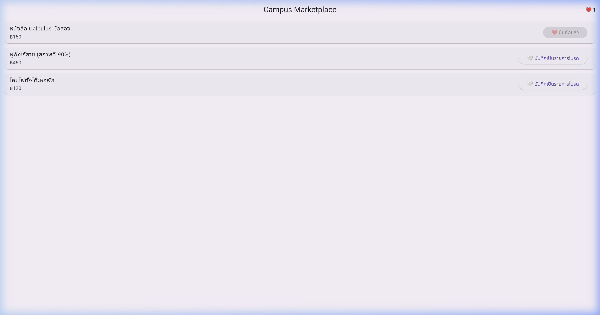
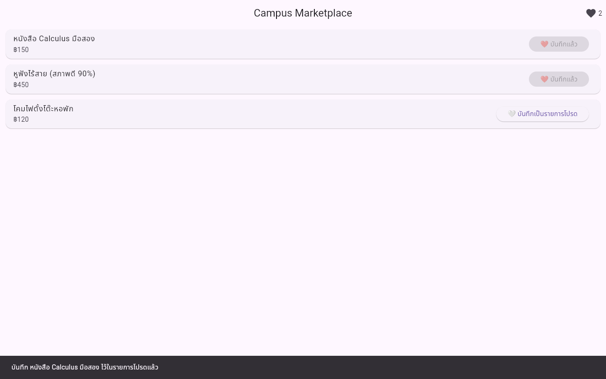
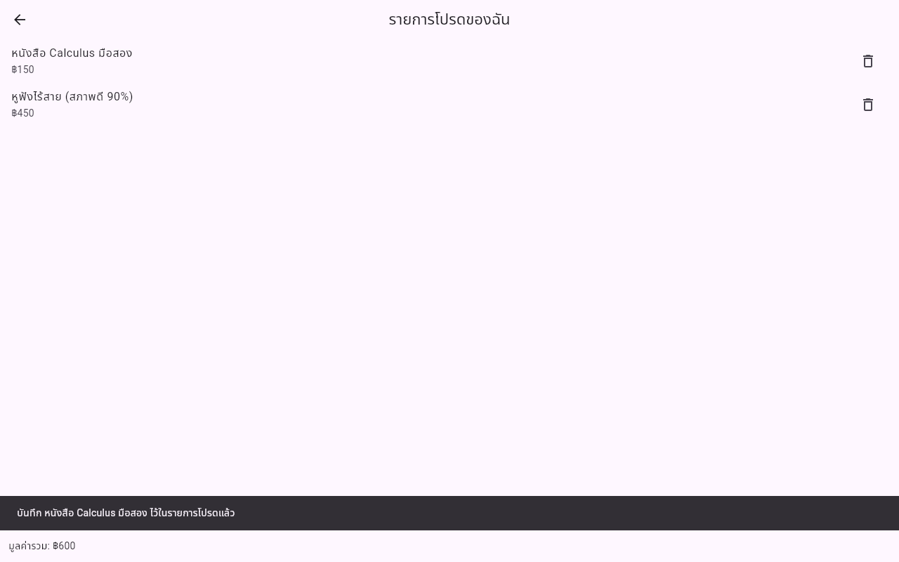
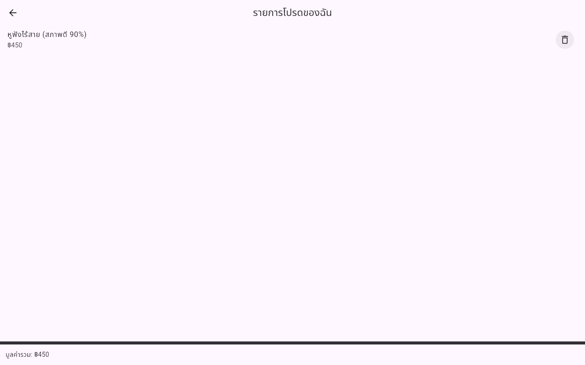
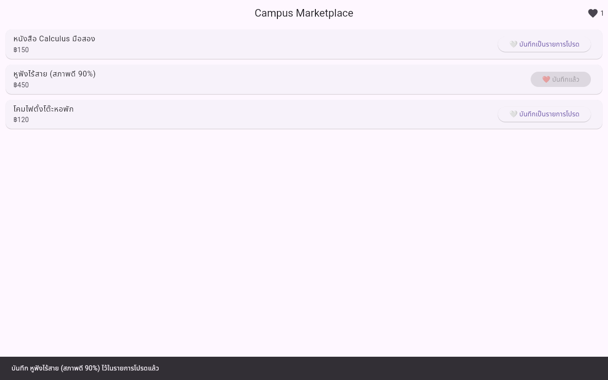
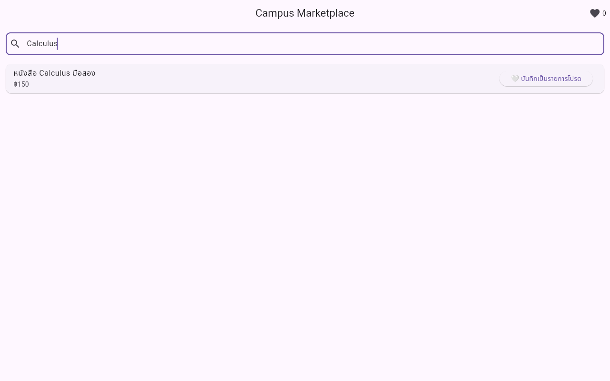
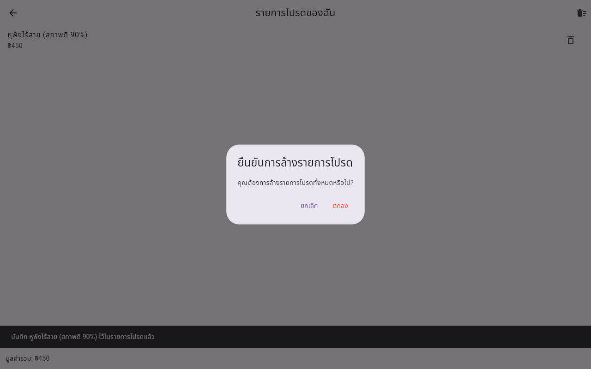

# รายงานการทดลอง Lab 5: State Management ใน Flutter (Campus Marketplace)

## 📌 ข้อมูลภาพรวม
- **วิชา:** Mobile and Distributed Software Development (MDSD)
- **บทเรียน:** สัปดาห์ที่ 5 การจัดการสถานะ (State Management) ใน Flutter
- **โปรเจกต์หลัก (Provider):** [`campus_marketplace`](campus_marketplace)
- **โปรเจกต์ทดลอง (Riverpod):** [`campus_marketplace_riverpod_trial`](campus_marketplace_riverpod_trial)
- **เอกสารใบงาน:** [`week05_lab_state_management.md`](week05_lab_state_management.md)

---

## 🎯 สรุปผลการทดลองตาม Checkpoint ทั้งหมด

### 📍 Checkpoint 1.1: Prop Drilling Demo
- **การทดสอบ:** กดบันทึกสินค้าเป็นรายการโปรด
- **รูปภาพประกอบ:**



- **คำถาม:** ถ้าต้องเพิ่มหน้าจอ `FavoritesPage` ที่ต้องแสดงรายการที่บันทึกไว้ชุดเดียวกัน แต่ถูก push แยกออกไปเป็นอีก Route หนึ่ง จะเกิดปัญหาอะไรกับโค้ดแบบ Prop Drilling นี้
```text
ข้าม Route แล้วจะไม่สามารถเข้าถึงข้อมูลได้ เพราะ State ถูกเก็บไว้แค่ใน HomePage หน้าเดียว ทำให้แชร์ข้อมูลข้ามหน้าจอไม่ได้และโค้ดผูกติดกันยุ่งเหยิง
```

---

### 📍 Checkpoint 2.1 & 2.2: Refactoring ด้วย Provider
- **การทดสอบ:** ซิงค์ข้อมูลรายการโปรดข้ามหน้าจอและทดสอบลบสินค้าออกจากหน้า Favorites

| รายการ | รูปภาพประกอบ |
|---|---|
| **หน้า Home เมื่อบันทึกสินค้า 2 ชิ้น** |  |
| **หน้า Favorites แสดงรายการและมูลค่ารวม** |  |
| **หน้า Favorites หลังกดปุ่มลบ** |  |
| **หน้า Home หลังย้อนกลับมา** |  |

---

### 📍 Checkpoint 3.1 & 3.2: การใช้ AI ช่วยวิเคราะห์ State Management

#### 🤖 สรุปตารางตัดสินใจจาก Gemini (ขั้นตอนที่ 3.1)
| ฟีเจอร์ | ประเภท State | เครื่องมือที่แนะนำ | เหตุผลสรุป |
| :--- | :--- | :--- | :--- |
| **Theme (Dark/Light)** | Global App State | **Riverpod / Provider** | เข้าถึงได้จากทุกหน้าในแอปที่ศูนย์กลาง |
| **Like Counter (Sync)** | Shared App State | **Riverpod / Provider** | ข้อมูลซิงค์ตรงกันระหว่างหน้า List และ Detail |
| **Heart Animation** | Ephemeral State | **setState** | ทำงานเฉพาะจุดภายใน Widget เดียว ประสิทธิภาพสูงสุด |

#### 📝 การประเมินคำตอบของ AI (ขั้นตอนที่ 3.2)
1. **เปรียบเทียบคำตอบของ Gemini กับกรอบการตัดสินใจในบทเรียน:**
```text
ตรงกันเรื่องแบ่ง Ephemeral State กับ App State แต่ต่างที่ Gemini แนะนำ Riverpod เป็นหลัก ส่วนบทเรียนให้เริ่มจาก Provider ก่อนเพราะเข้าใจง่ายกว่า
```

2. **การถามขอเหตุผลเพิ่มเติมเรื่อง Scope & BuildContext:**
```text
ถามเพิ่มเรื่องขอบเขต Widget และ BuildContext ได้คำตอบว่า Animation เป็น Ephemeral State ทำงานใน Widget เดียวจึงใช้ setState เพื่อประสิทธิภาพสูงสุด ส่วน Theme เป็น App State บนราก Tree ต้องใช้ Provider หรือ Riverpod ส่งต่อข้อมูลให้ทุก Widget rebuild ตาม
```

---

### 📍 Checkpoint 4.1 & 4.2: การแปลงโค้ดเป็น Riverpod (`campus_marketplace_riverpod_trial`)

#### 📷 รูปภาพทดสอบ Riverpod (Checkpoint 4.1)


#### 📊 ตารางเปรียบเทียบ Provider vs Riverpod (Checkpoint 4.2)
| หัวข้อ | Provider | Riverpod |
|---|---|---|
| **คลาสสร้าง State Model** | `ChangeNotifier` | `StateNotifier<T>` |
| **การเปลี่ยนค่า State** | แก้ไขข้อมูลโดยตรงและเรียก `notifyListeners()` | แทนที่ด้วย State ก้อนใหม่ `state = [...state, item]` |
| **การลงทะเบียน Provider** | `ChangeNotifierProvider` ภายใน Widget Tree | `StateNotifierProvider` ประกาศเป็น Global Variable |
| **คลาสของ Widget** | `StatelessWidget` | `ConsumerWidget` |
| **การดึง State มาแสดงผล** | `context.watch<FavoritesModel>()` | `ref.watch(favoritesProvider)` |
| **การเรียกใช้งาน Method** | `context.read<FavoritesModel>().add()` | `ref.read(favoritesProvider.notifier).add()` |

---

### 📍 Checkpoint 5.1: ออกแบบฟีเจอร์เพิ่มด้วยตนเอง

#### 📷 1. ฟีเจอร์ค้นหาสินค้า (Search Box)


#### 📷 2. Dialog ยืนยันการล้างรายการโปรดทั้งหมด


#### 📝 3. เหตุผลการเลือกชนิด State
```text
โจทย์ที่ 1 ช่องค้นหาสินค้า
เลือกใช้ Ephemeral State ด้วย setState เพราะคำค้นหาถูกใช้กรองรายการเฉพาะใน HomePage หน้าเดียว ไม่มี Route หรือ Widget อื่นต้องใช้ร่วม จึงใช้ setState ที่น้ำหนักเบาและตรงวัตถุประสงค์ที่สุด

โจทย์ที่ 2 ปุ่มล้างรายการโปรดทั้งหมด
เลือกใช้ App State ด้วย Provider เพราะต้องจัดการข้อมูลรายการโปรดส่วนกลาง โดยใช้ context.watch<FavoritesModel>() สำหรับตรวจสอบ favorites.items.isNotEmpty ในการซ่อนหรือแสดงปุ่ม และใช้ context.read<FavoritesModel>().clear() ใน onPressed เพื่อสั่งงานโดยไม่เกิดการสมัครฟังซ้ำซ้อน
```
